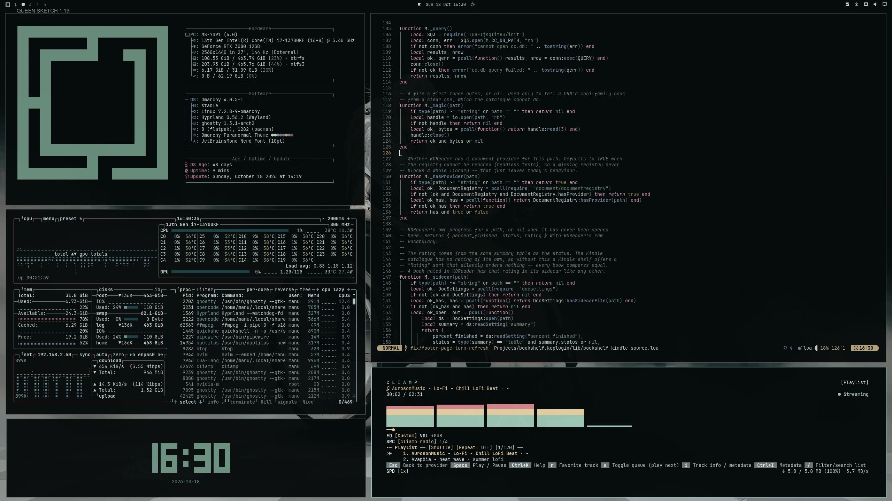
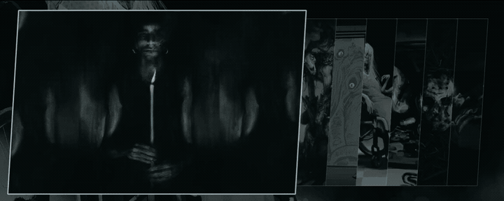

# omarchy-paranormal-theme

A horror theme for [Omarchy](https://omarchy.org): abandoned asylum, fog, cold and sickly light.
Cold black below the grey of the stock themes, bone-coloured text, a pale ectoplasm accent and aged warm tones.

<p align="center">
  
</p>

> **Wallpapers & copyright** — The artwork in this repository is not my own and is
> not covered by the MIT license. The images come from public wallpaper sites,
> mainly [wallhaven.cc](https://wallhaven.cc), and remain the property of their
> original authors. If one of them is yours and you'd rather it weren't here,
> [open an issue](../../issues) and I'll remove it immediately.

---

## 🎨 Palette

The dark ramp drops below the wallpapers' own void, so windows disappear into them.

| role               | hex       |     | role           | hex       |
| ------------------ | --------- | --- | -------------- | --------- |
| accent             | `#97c0c4` |     | red            | `#845e5f` |
| selection          | `#183f42` |     | yellow         | `#b3a381` |
| muted              | `#6b7576` |     | orange         | `#978867` |
| background         | `#060a0a` |     | green          | `#6b907f` |
| dark_background    | `#030606` |     | cyan           | `#729b9e` |
| darker_background  | `#020303` |     | blue           | `#647e94` |
| lighter_background | `#0d1112` |     | magenta        | `#997483` |
| foreground         | `#c5cece` |     | brown          | `#736850` |
| dark_foreground    | `#5c6565` |     | bright_red     | `#bc9294` |
| light_foreground   | `#8c9696` |     | bright_yellow  | `#ddcdaa` |
| bright_foreground  | `#ebefef` |     | bright_green   | `#9dc5b3` |
|                    |           |     | bright_cyan    | `#abd5d9` |
|                    |           |     | bright_blue    | `#9ebad2` |
|                    |           |     | bright_magenta | `#cba4b3` |

Everything else — terminals, Hyprland, btop, the Omarchy shell, Neovim, VS Code, the lock screen — is generated by Omarchy from `colors.toml`.

## 📦 Installation

```bash
omarchy theme install https://github.com/imanubdesigner/omarchy-paranormal-theme
omarchy theme set omarchy-paranormal-theme
```


## 🖼️ Backgrounds

<p align="center">
  
</p>

Seven wallpapers in `backgrounds/`, all recoloured towards the same cold cast. The colours were designed first, then applied to the images: the palette is the source, and the wallpapers follow it.

To add your own, drop them in:

```
~/.config/omarchy/backgrounds/paranormal
```

### Sources and credits

**The source images are not original work**, they belong to other artists. Five come from r/ImaginaryMonsters, two from wallhaven.cc:

| file                    | artwork                                             | source                                                                                                                             |
| ----------------------- | --------------------------------------------------- | ---------------------------------------------------------------------------------------------------------------------------------- |
| `nuclear_shelter`       | *The Night Shift* — Nuclear Shelter Me              | [r/ImaginaryMonsters](https://www.reddit.com/r/ImaginaryMonsters/comments/1wzdd1b/the_night_shift_by_nuclear_shelter_me/)          |
| `a0897on5porh1`         | *Visitor*, digital painting 2026                    | [r/ImaginaryMonsters](https://www.reddit.com/r/ImaginaryMonsters/comments/1wpz7m1/visitor_digital_painting_2026/)                  |
| `Jakub_Jagoda`          | *Feralith* — Jakub Jagoda                           | [r/ImaginaryMonsters](https://www.reddit.com/r/ImaginaryMonsters/comments/1wsqujx/feralith_by_jakub_jagoda/)                       |
| `queen_jerad.s.marantz` | *Mother* — Jerad S. Marantz                         | [r/ImaginaryMonsters](https://www.reddit.com/r/ImaginaryMonsters/comments/1wyywt6/mother_by_jerad_s_marantz/)                      |
| `vofpu0lzwduh1`         | *Sometimes when I'm feeling lonely I'll go to the…* | [r/ImaginaryMonsters](https://www.reddit.com/r/ImaginaryMonsters/comments/1x1dwdw/sometimes_when_im_feeling_lonely_ill_go_to_the/) |
| `wallhaven-57wdq3`      | —                                                   | [wallhaven.cc](https://wallhaven.cc/w/57wdq3)                                                                                      |
| `wallhaven-zx9y7o`      | —                                                   | [wallhaven.cc](https://wallhaven.cc/w/zx9y7o)                                                                                      |

### How they were made

The colours came first. `colors.toml` was designed on its own, and only afterwards applied to the images — the wallpapers follow the palette, not the other way round.

Two passes:

1. **Upscaled to 3840×2160.** The upscaling stretched the frames and left them thin at the edges, so the areas that came out empty were filled in by hand to rebuild what the originals had there.
2. **Recoloured by hand** in Photoshop and Photocraft: every hue in the frame was mapped onto a colour from the theme palette.

If you are the author of any of these works and would rather they weren't used this way, [open an issue](../../issues) and I'll remove them, no discussion. No license is granted for these images: they remain the property of their authors.

## 🧩 Icons

`Yaru-sage`. Change it by editing `icons.theme`.

## License

Released under the [MIT License](LICENSE). The license covers the theme's code and
configuration only: the wallpapers in `backgrounds/` remain the property of their
authors and are not licensed here (see *Sources and credits*).

---

*Part of the Omarchy theme family. Made for dark rooms and late hours.*