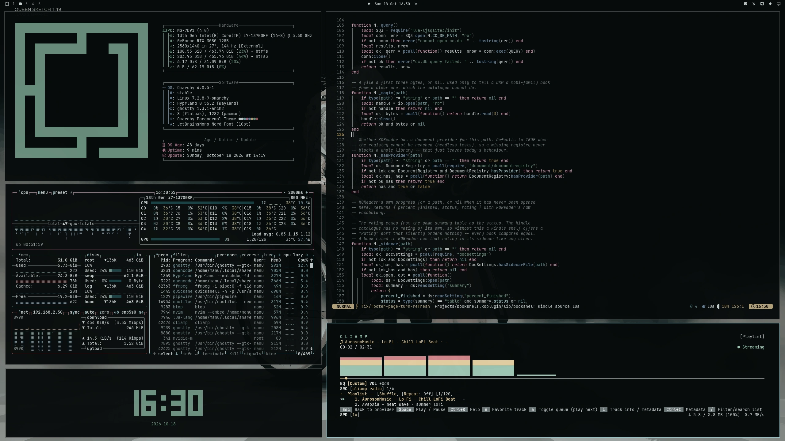
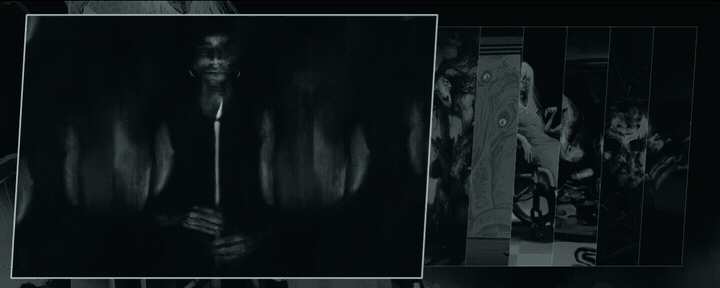

<div align="center">

# 👻 Paranormal

**Cold dark, bone, and ectoplasm.**  
A horror theme for Omarchy: abandoned asylum, fog, cold void, and sickly light.

[](https://omarchy.org)
[](#-palette)
[](#-palette)
[](https://obsidian.md)
[](LICENSE)
[](https://github.com/imanubdesigner/omarchy-paranormal-theme/stargazers)

</div>

<br>

<p align="center">
  
</p>

> **Wallpapers & copyright** — The artwork in this repository is not covered by the MIT license. The images come from public wallpaper sites, mainly [wallhaven.cc](https://wallhaven.cc) and r/ImaginaryMonsters, and remain the property of their original authors. If one of them is yours and you'd rather it weren't here, [open an issue](../../issues) and I'll remove it immediately.

---

### ✨ Highlights
- 👻 **Atmospheric Horror Aesthetic:** Void-black backgrounds (`#060a0a`) deeper than stock themes, allowing windows to sink seamlessly into wallpapers.
- 🧪 **Ectoplasm Light:** A pale, spectral cyan accent (`#97c0c4`) designed as the sole light source in the dark.
- 🖼️ **Handcrafted 4K Artworks:** 7 wallpapers upscaled to 3840×2160, with edges reconstructed by hand and recolored to match the cold cast.
- 📓 **Integrated Ecosystem:** Includes custom `obsidian.css` and `chromium.theme` handled automatically by Omarchy.
- 🕯️ **Low-Chroma Restraint:** Warm tones (clotted blood, ward paperwork, tungsten glow) remain restrained and muted so they never shout.

---

## 🚀 Installation

Install directly via the Omarchy CLI:

```bash
omarchy theme install https://github.com/imanubdesigner/omarchy-paranormal-theme
omarchy theme set omarchy-paranormal-theme
```

---

## 🎨 Palette

The dark ramp drops below the wallpapers' own void, so windows disappear into them. Everything else — terminals, Hyprland, btop, Omarchy shell, Neovim, VS Code, and lock screen — is generated by Omarchy from `colors.toml`.

| Preview | Name | Role / Lore | Hex |
| :---: | :--- | :--- | :--- |
|  | **Background** | Cold black / The void | `#060a0a` |
|  | **Foreground** | Bone | `#c5cece` |
|  | **Accent** | Ectoplasm: the only light | `#97c0c4` |
|  | **Selection** | Raised surface | `#183f42` |
|  | **Red** | Clotted blood | `#845e5f` |
|  | **Cyan** | Spectral light | `#729b9e` |
|  | **Green** | Asylum mist | `#6b907f` |
|  | **Yellow** | Ward paperwork | `#b3a381` |
|  | **Blue** | Beyond the glass | `#647e94` |
|  | **Orange** | Tungsten lamp | `#978867` |
|  | **Muted** | Grey fog | `#6b7576` |

---

## 🖼️ Backgrounds

<p align="center">
  
</p>

Seven wallpapers in `backgrounds/`, all recoloured towards the same cold cast. The colours were designed first, then applied to the images: the palette is the source, and the wallpapers follow it.

To add your own, drop them into:

```bash
~/.config/omarchy/backgrounds/paranormal
```

### Sources & Credits

The source images belong to their respective original artists. Five come from r/ImaginaryMonsters, two from wallhaven.cc:

| File | Artwork | Source |
| :--- | :--- | :--- |
| `nuclear_shelter` | *The Night Shift* | Nuclear Shelter Me | [r/ImaginaryMonsters](https://www.reddit.com/r/ImaginaryMonsters/comments/1wzdd1b/the_night_shift_by_nuclear_shelter_me/) |
| `a0897on5porh1` | *Visitor*, digital painting 2026 | [r/ImaginaryMonsters](https://www.reddit.com/r/ImaginaryMonsters/comments/1wpz7m1/visitor_digital_painting_2026/) |
| `Jakub_Jagoda` | *Feralith* | Jakub Jagoda | [r/ImaginaryMonsters](https://www.reddit.com/r/ImaginaryMonsters/comments/1wsqujx/feralith_by_jakub_jagoda/) |
| `queen_jerad.s.marantz` | *Mother* | Jerad S. Marantz | [r/ImaginaryMonsters](https://www.reddit.com/r/ImaginaryMonsters/comments/1wyywt6/mother_by_jerad_s_marantz/) |
| `vofpu0lzwduh1` | *Sometimes when I'm feeling lonely I'll go to the…* | [r/ImaginaryMonsters](https://www.reddit.com/r/ImaginaryMonsters/comments/1x1dwdw/sometimes_when_im_feeling_lonely_ill_go_to_the/) |
| `wallhaven-57wdq3` | Untitled | [wallhaven.cc](https://wallhaven.cc/w/57wdq3) |
| `wallhaven-zx9y7o` | Untitled | [wallhaven.cc](https://wallhaven.cc/w/zx9y7o) |

### How They Were Made

The colours came first. `colors.toml` was designed on its own, and only afterwards applied to the images: the wallpapers follow the palette, not the other way round.

Two passes:
1. **Upscaled to 3840×2160:** The upscaling stretched the frames and left them thin at the edges, so the areas that came out empty were filled in by hand to rebuild what the originals had there.
2. **Recoloured by hand:** In Photoshop and PhotoCraft, every hue in the frame was mapped onto a colour from the theme palette.

If you are the author of any of these works and would rather they weren't used this way, [open an issue](../../issues) and I'll remove them immediately. No license is granted for these images: they remain the property of their authors.

---

## 🧩 Icons

`Yaru-sage`. Change it anytime by editing `icons.theme`.

## 📄 License

Released under the [MIT License](LICENSE). The license covers the theme's code and configuration only: the wallpapers in `backgrounds/` remain the property of their authors (see *Sources & Credits*).

---

<div align="center">

*Part of the Omarchy theme family. Made for dark rooms and late hours.*

### ⭐ Support & Stargazers
If you enjoy the chilling atmosphere of Paranormal on your desktop, please consider leaving a **Star** ⭐!

</div>
